# 🗄️ EventTick — Đặc Tả Cơ Sở Dữ Liệu Vật Lý (Database Specification)

Tài liệu này định nghĩa chi tiết cấu trúc **18 Bảng / Collections** cho hệ thống **EventTick (MERN Stack)**, đồng bộ 100% với thiết kế Physical ERD chuẩn của dự án, đồng thời giải quyết triệt để nghiệp vụ **Vé đứng (General Admission)** trong bảng `orders` và thiết lập mối quan hệ **1-1** giữa **`orders` và `payments`**.

> **🔄 Cập nhật cấu trúc suất diễn:** Thêm bảng **`event_sessions`** (suất diễn). Quan hệ mới: `events (1) → (N) event_sessions (1) → (N) ticket_tiers & seats`. Các bảng `ticket_tiers`, `seats`, `orders`, `tickets` có thêm cột **`session_id`** để biết thuộc suất diễn nào. Mỗi suất có hạng vé, ghế và tồn kho riêng.

> **🗺️ Cập nhật sơ đồ chỗ ngồi:** Thêm bảng **`seatmap_layouts`** (mỗi sự kiện 1 bản ghi: nội dung SVG mặt bằng + cấu hình từng khu). Organizer gửi `zone_map.svg` + `seating_manifest.xlsx`, **Admin** tải lên để hệ thống dựng sơ đồ: khu `SEC_…` trong SVG ↔ `seatmap_layouts.sections[].section_id` ↔ `seats.section_name`. Trường `ticket_tiers.zone_type` (`"GA"` / `"SEATED"`) phân định khu vực vé đứng và vé ngồi. Các trường cũ như `ticket_tiers.zone_shape` và `event_sessions.seat_map` (vẽ tay) **đã được loại bỏ**.

> **🔔 Cập nhật luồng Organizer ↔ Admin (12/11/2026):** Thêm bảng **`notifications`** (thông báo trong ứng dụng, mỗi bản ghi thuộc một người nhận). Thêm trường `events.status_history` (lịch sử đổi trạng thái), `e_contracts.rejection_reason` (lý do Organizer từ chối ký), `payout_settlements.status = 'REJECTED'` cùng `rejection_reason`, `rejected_by_admin`. Chi tiết nghiệp vụ ở [`eventtick_project_readme.md`](eventtick_project_readme.md) mục 4.3. **Sau khi pull phải chạy `npm run db:init`** để cập nhật validator.

---

## 📊 1. Sơ Đồ Physical ERD Chuẩn Hóa (18 Bảng)

Dưới đây là mã Mermaid ERD đã được cập nhật:
* Chuyển quan hệ `orders` — `payments` thành **1-1 (`||--o|`)** với `order_id FK,UK`.
* Bổ sung cột `items_snapshot` (`json`) vào bảng `orders` để lưu chi tiết hạng vé và số lượng khi khách mua **Vé đứng** (vì vé đứng chưa có `tickets` lúc đang chờ thanh toán và cũng không có bản ghi trong bảng `seats`).
* Bổ sung `zone_type` (`GA`, `SEATED`) vào `ticket_tiers`.
* Đã loại bỏ các bảng không còn sử dụng: `reviews`, `wishlists_follows`, `audit_logs`.

```mermaid
%%{init: {
  'theme': 'neutral',
  'themeVariables': {
    'fontFamily': 'Arial, Helvetica, sans-serif',
    'fontSize': '13px'
  }
}}%%
erDiagram
    %% ================= QUAN HỆ GIỮA CÁC BẢNG =================
    users ||--o| organizer_profiles : "1-1 KYC"
    users ||--o{ events : "organizes"
    users ||--o{ staff_assignments : "assigned_as_staff"
    events ||--o{ staff_assignments : "has_staff"
    categories ||--o{ events : "categorizes"
    events ||--|| e_contracts : "bound_by"
    events ||--o{ event_sessions : "has_sessions"
    event_sessions ||--o{ ticket_tiers : "has_tiers"
    event_sessions ||--o{ seats : "has_seatmap"
    ticket_tiers ||--o{ seats : "prices_seats"
    events ||--o| seatmap_layouts : "has_layout"
    event_sessions ||--o{ orders : "booked_for"
    event_sessions ||--o{ tickets : "admits"
    events ||--o{ vouchers : "offers"
    users ||--o{ orders : "places"
    events ||--o{ orders : "receives"
    vouchers |o--o{ orders : "applied_to"
    orders ||--o| payments : "1-1 paid_via"
    orders ||--o{ tickets : "generates"
    ticket_tiers ||--o{ tickets : "defines"
    seats |o--o| tickets : "assigned_to"
    users ||--o{ tickets : "owns"
    tickets ||--o| resale_listings : "listed_on"
    users ||--o{ resale_listings : "sells"
    orders ||--o{ refund_requests : "requests_refund"
    events ||--o| payout_settlements : "settled_via"
    e_contracts ||--o| payout_settlements : "calculates_fee"
    users ||--o{ notifications : "receives"

    %% ================= CHI TIẾT 18 BẢNG =================
    users {
        uuid user_id PK
        varchar email UK "Not Null"
        varchar password_hash "Not Null"
        varchar full_name "Not Null"
        varchar phone
        text avatar_url
        enum role "CUSTOMER, ORGANIZER, STAFF, ADMIN"
        enum status "ACTIVE, BLOCKED, PENDING"
        varchar google_id
        json default_vat_info
        timestamp created_at
    }
    organizer_profiles {
        uuid profile_id PK
        uuid user_id FK,UK "Not Null"
        varchar organization_name "Not Null"
        enum business_type "INDIVIDUAL, ENTERPRISE"
        varchar tax_code "Not Null"
        text id_card_or_license_url "Not Null"
        varchar bank_name "Not Null"
        varchar bank_account_no "Not Null"
        varchar bank_account_holder "Not Null"
        enum kyc_status "PENDING, VERIFIED, REJECTED"
        uuid verified_by FK
        timestamp verified_at
    }
    staff_assignments {
        uuid assignment_id PK
        uuid staff_user_id FK "Not Null"
        uuid organizer_id FK "Not Null"
        uuid event_id FK "Not Null"
        varchar assigned_gate
        boolean is_active
    }
    categories {
        uuid category_id PK
        varchar name "Not Null"
        varchar slug UK "Not Null"
        boolean is_active
    }
    events {
        uuid event_id PK
        uuid organizer_id FK "Not Null"
        uuid category_id FK "Not Null"
        varchar title "Not Null"
        text description "Not Null"
        text banner_url "Not Null"
        varchar venue_name "Not Null"
        varchar city "Not Null"
        timestamp start_time "Not Null"
        timestamp end_time "Not Null"
        boolean has_seat_map
        boolean allow_resale
        decimal max_resale_markup_pct
        json custom_form_schema
        text legal_doc_url
        enum status "DRAFT, PENDING, APPROVED, PUBLISHED, CANCELLED, ENDED"
        boolean is_featured_banner
        json status_history "Lịch sử đổi trạng thái (mở rộng)"
        text rejection_reason "Lý do từ chối (mở rộng)"
    }
    event_sessions {
        uuid session_id PK
        uuid event_id FK "Not Null"
        varchar name "Not Null"
        timestamp start_time "Not Null"
        timestamp end_time "Not Null"
        enum status "SCHEDULED, CANCELLED, ENDED"
    }
    e_contracts {
        uuid contract_id PK
        uuid event_id FK,UK "Not Null"
        uuid organizer_id FK "Not Null"
        uuid approved_by_admin FK
        decimal commission_rate_pct "Not Null"
        text contract_terms_html "Not Null"
        text organizer_signature_url
        text signed_pdf_url
        varchar signer_ip
        timestamp signed_at
        text rejection_reason "Lý do Organizer từ chối ký (mở rộng)"
        enum status "WAITING_SIGN, SIGNED, REJECTED"
    }
    ticket_tiers {
        uuid tier_id PK
        uuid event_id FK "Not Null"
        uuid session_id FK "Not Null"
        varchar name "Not Null"
        decimal price "Not Null"
        int total_quantity "Not Null"
        int available_quantity "Not Null"
        int min_per_order
        int max_per_order
        timestamp sale_start_time "Not Null"
        timestamp sale_end_time "Not Null"
        varchar zone_color
        enum zone_type "GA, SEATED"
    }
    seats {
        uuid seat_id PK
        uuid event_id FK "Not Null"
        uuid session_id FK "Not Null"
        uuid tier_id FK "Not Null"
        varchar section_name "Not Null"
        varchar row_label "Not Null"
        varchar seat_number "Not Null"
        float coord_x
        float coord_y
        enum status "AVAILABLE, LOCKED, SOLD"
        uuid locked_by_user_id FK
        timestamp lock_expires_at
    }
    seatmap_layouts {
        uuid layout_id PK
        uuid event_id FK,UK "Not Null"
        text svg_content "Not Null"
        json stage_ids
        json sections "Not Null"
        uuid updated_by FK
        timestamp updated_at
    }
    vouchers {
        uuid voucher_id PK
        uuid event_id FK "Not Null"
        varchar code "Unique per event_id"
        enum discount_type "PERCENT, FIXED"
        decimal discount_value "Not Null"
        decimal max_discount_amount
        decimal min_order_amount
        int usage_limit "Not Null"
        int used_count "Default 0"
        int max_per_user "Default 1"
        timestamp valid_from "Not Null"
        timestamp valid_until "Not Null"
        boolean is_active
    }
    orders {
        uuid order_id PK
        uuid buyer_id FK "Not Null"
        uuid event_id FK "Not Null"
        uuid session_id FK "Not Null"
        uuid voucher_id FK
        varchar order_code UK "Not Null"
        enum order_type "PRIMARY, RESALE"
        json resale_listing_ids "Nullable"
        json items_snapshot "Not Null (Lưu tier_id, quantity & seat_ids)"
        decimal subtotal_amount "Not Null"
        decimal discount_amount "Default 0"
        decimal total_amount "Not Null"
        json attendee_form_answers
        json vat_invoice_info
        enum status "PENDING_PAYMENT, PAID, EXPIRED, CANCELLED, REFUNDED"
        timestamp lock_expires_at
        timestamp created_at
    }
    payments {
        uuid payment_id PK
        uuid order_id FK,UK "Not Null (1-1 with orders)"
        enum gateway "VNPAY, VIETQR, MOMO, STRIPE"
        varchar transaction_ref UK "Not Null"
        decimal amount "Not Null"
        enum status "INITIATED, SUCCESS, FAILED, REFUNDED"
        json webhook_payload
        timestamp paid_at
    }
    tickets {
        uuid ticket_id PK
        uuid order_id FK "Not Null"
        uuid event_id FK "Not Null"
        uuid session_id FK "Not Null"
        uuid tier_id FK "Not Null"
        uuid seat_id FK "Nullable (Null nếu là Vé đứng)"
        uuid owner_id FK "Not Null"
        varchar ticket_code UK "Not Null"
        varchar qr_hash_signature UK "Not Null"
        enum status "VALID, USED, LISTED_RESALE, RESOLD_INVALID, REFUNDED"
        timestamp checked_in_at
        uuid checked_in_by FK
    }
    resale_listings {
        uuid listing_id PK
        uuid ticket_id FK,UK "Not Null"
        uuid seller_id FK "Not Null"
        uuid buyer_order_id FK "Nullable"
        decimal original_price "Not Null"
        decimal resale_price "Not Null"
        enum status "ACTIVE, RESERVED, SOLD, CANCELLED"
        timestamp reserved_until
        varchar bundle_code
        boolean allow_partial
        json payout_bank
        decimal payout_amount
        enum payout_status "NONE, PENDING, PAID"
        varchar payout_ref
        timestamp paid_out_at
        uuid paid_out_by FK
        timestamp created_at
    }
    refund_requests {
        uuid refund_id PK
        uuid order_id FK "Not Null"
        uuid ticket_id FK "Nullable"
        uuid user_id FK "Not Null"
        enum refund_type "EVENT_BULK_REFUND"
        decimal refund_amount "Not Null"
        text reason "Not Null"
        enum status "PROCESSING, COMPLETED, REJECTED"
        timestamp processed_at
    }
    payout_settlements {
        uuid settlement_id PK
        uuid event_id FK,UK "Not Null"
        uuid organizer_id FK "Not Null"
        uuid contract_id FK "Not Null"
        decimal gross_revenue "Not Null"
        decimal total_refunded "Default 0"
        decimal platform_commission_amt "Not Null"
        decimal net_payout_amount "Not Null"
        text bank_transfer_receipt_url
        enum status "REQUESTED, APPROVED, SETTLED, REJECTED"
        text rejection_reason "Lý do Admin từ chối (mở rộng)"
        uuid rejected_by_admin FK
        uuid settled_by_admin FK
        timestamp settled_at
    }
    notifications {
        uuid notification_id PK
        uuid user_id FK "Not Null"
        varchar type "Not Null"
        varchar title "Not Null"
        varchar body
        varchar link
        timestamp read_at
        timestamp created_at "Not Null"
    }
```



---

## 📌 2. Tổng Quan Danh Sách 18 Bảng / Collections

| STT | Tên Bảng / Collection | Phân hệ (Module) | Mô tả chức năng chính |
| :--- | :--- | :--- | :--- |
| 01 | `users` | Identity & KYC | Lưu thông tin tài khoản cho cả Customer, Organizer, Staff và Admin |
| 02 | `organizer_profiles` | Identity & KYC | Hồ sơ pháp nhân KYC của Nhà tổ chức (Quan hệ `1-1` với `users`) |
| 03 | `staff_assignments` | Identity & KYC | Phân công nhân viên soát vé (`STAFF`) theo từng sự kiện và cổng |
| 04 | `categories` | Event & Inventory | Danh mục phân loại sự kiện |
| 05 | `events` | Event & Inventory | Thông tin chi tiết sự kiện, cờ bật/tắt sơ đồ ghế (`has_seat_map`) |
| 06 | `event_sessions` | Event & Inventory | Suất diễn của sự kiện (`1-N` với `events`); mỗi suất có hạng vé, ghế và tồn kho riêng |
| 07 | `e_contracts` | Contract & Finance | Hợp đồng dịch vụ điện tử giữa Sàn và Organizer (Quan hệ `1-1` với `events`) |
| 08 | `ticket_tiers` | Event & Inventory | Hạng vé, giá vé, phân loại khu vực (`zone_type`: `GA` / `SEATED`) và tồn kho (`available_quantity`) theo từng **suất diễn** |
| 09 | `seats` | Event & Inventory | Vị trí ghế ngồi vật lý theo từng **suất diễn** (Chỉ dùng khi `events.has_seat_map = true`) |
| 10 | `seatmap_layouts` | Event & Inventory | Sơ đồ chỗ ngồi của sự kiện: SVG mặt bằng + cấu hình khu, do Admin dựng từ file của Organizer (`1-1` với `events`) |
| 11 | `vouchers` | Booking & Payment | Mã giảm giá và điều kiện áp dụng theo sự kiện |
| 12 | `orders` | Booking & Payment | Đơn đặt vé cho **1 suất diễn**, dùng `items_snapshot` xử lý cả **Vé đứng** và **Vé ngồi** |
| 13 | `payments` | Booking & Payment | Giao dịch thanh toán trực tuyến (Quan hệ **`1-1`** với `orders`) |
| 14 | `tickets` | Ticket & Check-in | Vé điện tử phát hành sau khi `orders` thanh toán thành công (`seat_id` Nullable) |
| 15 | `resale_listings` | Ticket & Check-in | Bài đăng bán lại vé trên chợ chuyển nhượng chính thức |
| 16 | `refund_requests` | Contract & Finance | Bản ghi hoàn tiền khi sự kiện bị huỷ (hoàn hàng loạt) |
| 17 | `payout_settlements` | Contract & Finance | Đối soát doanh thu và giải ngân cho Nhà tổ chức (`1-1` với `events`); Admin có thể từ chối, Organizer gửi lại trên cùng bản ghi |
| 18 | `notifications` | Notification | Thông báo trong ứng dụng (chuông ở Dashboard), `1-N` với `users`; email gửi kèm không lưu bảng |

---

## 🔐 3. Đặc Tả Chi Tiết Các Bảng (Data Dictionary)

### 3.1. Bảng `users`
Lưu trữ toàn bộ người dùng hệ thống (không tách bảng `customer_profiles`, mọi thông tin của Customer như họ tên, SĐT, cấu hình xuất hóa đơn VAT mặc định đều nằm trực tiếp tại đây).

| Tên cột (Field) | Kiểu dữ liệu | Ràng buộc | Mô tả chi tiết |
| :--- | :--- | :--- | :--- |
| `user_id` | `UUID / ObjectId` | `PK` | Khóa chính định danh người dùng |
| `email` | `VARCHAR(255)` | `UK, Not Null` | Địa chỉ email đăng nhập duy nhất |
| `password_hash` | `VARCHAR(255)` | `Not Null` | Mật khẩu đã mã hóa `bcrypt` |
| `full_name` | `VARCHAR(150)` | `Not Null` | Họ và tên đầy đủ của người dùng |
| `phone` | `VARCHAR(20)` | `Nullable` | Số điện thoại liên hệ |
| `avatar_url` | `TEXT` | `Nullable` | Đường dẫn ảnh đại diện trên Cloudinary |
| `role` | `ENUM` | `Not Null` | `'CUSTOMER'`, `'ORGANIZER'`, `'STAFF'`, `'ADMIN'` |
| `status` | `ENUM` | `Not Null` | `'ACTIVE'`, `'BLOCKED'`, `'PENDING'` |
| `google_id` | `VARCHAR(100)` | `Nullable` | Định danh đăng nhập qua Google OAuth2 |
| `default_vat_info` | `JSON` | `Nullable` | Lưu thông tin xuất hóa đơn VAT mặc định của khách hàng |
| `created_at` | `TIMESTAMP` | `Not Null` | Thời điểm tạo tài khoản |

### 3.2. Bảng `organizer_profiles`
Quan hệ **1-1** với bảng `users` dành riêng cho người dùng đăng ký làm Nhà tổ chức sự kiện (UC21, UC38).

| Tên cột (Field) | Kiểu dữ liệu | Ràng buộc | Mô tả chi tiết |
| :--- | :--- | :--- | :--- |
| `profile_id` | `UUID / ObjectId` | `PK` | Khóa chính hồ sơ nhà tổ chức |
| `user_id` | `UUID / ObjectId` | `FK, UK, Not Null` | Tham chiếu `1-1` tới `users.user_id` |
| `organization_name` | `VARCHAR(255)` | `Not Null` | Tên doanh nghiệp / Đơn vị tổ chức |
| `business_type` | `ENUM` | `Not Null` | `'INDIVIDUAL'`, `'ENTERPRISE'` |
| `tax_code` | `VARCHAR(50)` | `Not Null` | Mã số thuế doanh nghiệp / cá nhân |
| `id_card_or_license_url` | `TEXT` | `Not Null` | Ảnh CCCD hoặc Giấy phép ĐKKD trên Cloudinary |
| `bank_name` | `VARCHAR(100)` | `Not Null` | Tên ngân hàng nhận tiền đối soát |
| `bank_account_no` | `VARCHAR(50)` | `Not Null` | Số tài khoản ngân hàng |
| `bank_account_holder` | `VARCHAR(150)` | `Not Null` | Tên chủ tài khoản thụ hưởng |
| `kyc_status` | `ENUM` | `Not Null` | `'PENDING'`, `'VERIFIED'`, `'REJECTED'` |
| `verified_by` | `UUID / ObjectId` | `FK, Nullable` | Admin thực hiện duyệt (`users.user_id`) |
| `verified_at` | `TIMESTAMP` | `Nullable` | Thời điểm duyệt KYC |

### 3.3. Bảng `staff_assignments`
Phân công nhân viên soát vé cho từng sự kiện (UC30, UC35).

| Tên cột (Field) | Kiểu dữ liệu | Ràng buộc | Mô tả chi tiết |
| :--- | :--- | :--- | :--- |
| `assignment_id` | `UUID / ObjectId` | `PK` | Khóa chính bản ghi phân công |
| `staff_user_id` | `UUID / ObjectId` | `FK, Not Null` | Nhân viên soát vé (`users.user_id`) |
| `organizer_id` | `UUID / ObjectId` | `FK, Not Null` | Nhà tổ chức phân công (`users.user_id`) |
| `event_id` | `UUID / ObjectId` | `FK, Not Null` | Sự kiện được giao soát vé (`events.event_id`) |
| `assigned_gate` | `VARCHAR(100)` | `Nullable` | Cổng phụ trách (VD: `Gate A`, `VIP Entrance`) |
| `is_active` | `BOOLEAN` | `Default true` | Quyền quét mã QR tại sự kiện |

### 3.4. Bảng `categories`
Phân loại sự kiện (UC05, UC40).

| Tên cột (Field) | Kiểu dữ liệu | Ràng buộc | Mô tả chi tiết |
| :--- | :--- | :--- | :--- |
| `category_id` | `UUID / ObjectId` | `PK` | Khóa chính danh mục |
| `name` | `VARCHAR(100)` | `Not Null` | Tên danh mục (Nhạc sống, Sân khấu, Thể thao...) |
| `slug` | `VARCHAR(100)` | `UK, Not Null` | Chuỗi URL thân thiện SEO |
| `is_active` | `BOOLEAN` | `Default true` | Trạng thái hiển thị |

### 3.5. Bảng `events`
Thông tin sự kiện và cấu hình chính sách (UC22, UC23, UC26, UC39).

| Tên cột (Field) | Kiểu dữ liệu | Ràng buộc | Mô tả chi tiết |
| :--- | :--- | :--- | :--- |
| `event_id` | `UUID / ObjectId` | `PK` | Khóa chính sự kiện |
| `organizer_id` | `UUID / ObjectId` | `FK, Not Null` | Nhà tổ chức (`users.user_id`) |
| `category_id` | `UUID / ObjectId` | `FK, Not Null` | Danh mục (`categories.category_id`) |
| `title` | `VARCHAR(255)` | `Not Null` | Tiêu đề sự kiện |
| `description` | `TEXT` | `Not Null` | Nội dung chi tiết sự kiện |
| `banner_url` | `TEXT` | `Not Null` | Ảnh banner lưu trên Cloudinary |
| `venue_name` | `VARCHAR(255)` | `Not Null` | Địa điểm tổ chức |
| `city` | `VARCHAR(100)` | `Not Null` | Tỉnh / Thành phố |
| `start_time` | `TIMESTAMP` | `Not Null` | Thời gian bắt đầu — **khoảng bao trùm**: bằng `start_time` sớm nhất của các `event_sessions` |
| `end_time` | `TIMESTAMP` | `Not Null` | Thời gian kết thúc — bằng `end_time` muộn nhất của các `event_sessions` |
| `has_seat_map` | `BOOLEAN` | `Default false` | `false`: **Sự kiện Vé đứng (GA)** \| `true`: **Có sơ đồ ghế** |
| `allow_resale` | `BOOLEAN` | `Default false` | Cho phép đăng bán lại vé |
| `max_resale_markup_pct` | `DECIMAL(5,2)` | `Default 0` | Trần `%` tăng giá tối đa khi bán lại |
| `custom_form_schema` | `JSON` | `Nullable` | Cấu hình câu hỏi khảo sát khi mua vé |
| `legal_doc_url` | `TEXT` | `Nullable` | Hồ sơ cấp phép biểu diễn |
| `status` | `ENUM` | `Not Null` | `'DRAFT'`, `'PENDING'`, `'APPROVED'`, `'PUBLISHED'`, `'CANCELLED'`, `'ENDED'`. Chỉ `PUBLISHED` (và `ENDED` để xem lại) hiện công khai và cho đặt vé; `APPROVED` nghĩa là đã duyệt nhưng **chưa ký hợp đồng** nên chưa mở bán. `ENDED` do job nền tự đặt khi `end_time` đã qua |
| `is_featured_banner` | `BOOLEAN` | `Default false` | Đưa lên banner nổi bật trang chủ |

### 3.6. Bảng `event_sessions` (Suất diễn)
Một sự kiện có thể diễn ra nhiều lần (nhiều ngày / nhiều khung giờ). Mỗi **suất diễn** quản lý **hạng vé, sơ đồ ghế và tồn kho riêng**. Cấu trúc liên kết: `events (1) → (N) event_sessions (1) → (N) ticket_tiers & seats`. Sự kiện chỉ diễn ra một lần vẫn có đúng 1 bản ghi `event_sessions`.

| Tên cột (Field) | Kiểu dữ liệu | Ràng buộc | Mô tả chi tiết |
| :--- | :--- | :--- | :--- |
| `session_id` | `UUID / ObjectId` | `PK` | Khóa chính suất diễn |
| `event_id` | `UUID / ObjectId` | `FK, Not Null` | Thuộc sự kiện (`events.event_id`) |
| `name` | `VARCHAR(255)` | `Not Null` | Tên suất (VD: `Đêm 1`, `Suất 19h ngày 10/12`) |
| `start_time` | `TIMESTAMP` | `Not Null` | Thời gian bắt đầu suất diễn |
| `end_time` | `TIMESTAMP` | `Not Null` | Thời gian kết thúc (`> start_time`) |
| `status` | `ENUM` | `Not Null` | `'SCHEDULED'`, `'CANCELLED'`, `'ENDED'` |

**Index:** `(event_id, start_time)`, `(start_time)`.

### 3.7. Bảng `e_contracts`
Hợp đồng điện tử giữa Sàn và Nhà tổ chức, quan hệ **1-1** với `events` (UC27, UC38, UC41).

| Tên cột (Field) | Kiểu dữ liệu | Ràng buộc | Mô tả chi tiết |
| :--- | :--- | :--- | :--- |
| `contract_id` | `UUID / ObjectId` | `PK` | Khóa chính hợp đồng |
| `event_id` | `UUID / ObjectId` | `FK, UK, Not Null` | Tham chiếu `1-1` tới `events.event_id` |
| `organizer_id` | `UUID / ObjectId` | `FK, Not Null` | Nhà tổ chức ký kết (`users.user_id`) |
| `approved_by_admin` | `UUID / ObjectId` | `FK, Nullable` | Admin khởi tạo hợp đồng (`users.user_id`) |
| `commission_rate_pct` | `DECIMAL(5,2)` | `Not Null` | Phần trăm hoa hồng của sàn (VD: `5.00`%) |
| `contract_terms_html` | `TEXT` | `Not Null` | Điều khoản hợp đồng dạng HTML |
| `organizer_signature_url`| `TEXT` | `Nullable` | Ảnh chữ ký vẽ trên Canvas của Organizer |
| `signed_pdf_url` | `TEXT` | `Nullable` | Đường dẫn file PDF hợp đồng hoàn chỉnh sau khi ký |
| `signer_ip` | `VARCHAR(45)` | `Nullable` | Địa chỉ IP lúc ký hợp đồng |
| `signed_at` | `TIMESTAMP` | `Nullable` | Thời điểm hoàn tất ký số |
| `rejection_reason` | `VARCHAR(1000)` | `Nullable` | **Mở rộng.** Lý do Organizer từ chối ký (bắt buộc khi từ chối). Admin đọc để chỉnh hoa hồng / điều khoản |
| `status` | `ENUM` | `Not Null` | `'WAITING_SIGN'`, `'SIGNED'`, `'REJECTED'`. Hợp đồng `REJECTED` **được tái sử dụng** khi Admin duyệt lại (đổi lại `WAITING_SIGN`, xoá `rejection_reason`) vì `event_id` là unique |

### 3.8. Bảng `ticket_tiers`
Quản lý các hạng vé và tồn kho (Phục vụ trực tiếp việc trừ số lượng tồn kho `available_quantity` cho **Vé đứng** lẫn **Vé ngồi**) (UC10, UC25). Cột `zone_shape` cũ đã được loại bỏ hoàn toàn khỏi schema.

| Tên cột (Field) | Kiểu dữ liệu | Ràng buộc | Mô tả chi tiết |
| :--- | :--- | :--- | :--- |
| `tier_id` | `UUID / ObjectId` | `PK` | Khóa chính hạng vé |
| `event_id` | `UUID / ObjectId` | `FK, Not Null` | Thuộc sự kiện (`events.event_id`) — lưu kèm để truy vấn nhanh |
| **`session_id`** | **`UUID / ObjectId`** | **`FK, Not Null`** | **Thuộc suất diễn (`event_sessions.session_id`)** — tồn kho tính riêng từng suất |
| `name` | `VARCHAR(150)` | `Not Null` | Tên hạng vé (VD: `Standing Zone A`, `VIP Seated`) |
| `price` | `DECIMAL(12,2)` | `Not Null` | Giá bán của 1 vé |
| `total_quantity` | `INT` | `Not Null` | Tổng số vé phát hành |
| `available_quantity` | `INT` | `Not Null` | Số lượng vé còn lại có thể mua (`>= 0`) |
| `min_per_order` | `INT` | `Default 1` | Số vé tối thiểu trong 1 lần đặt |
| `max_per_order` | `INT` | `Default 4` | Số vé tối đa trong 1 lần đặt |
| `sale_start_time` | `TIMESTAMP` | `Not Null` | Thời gian mở bán |
| `sale_end_time` | `TIMESTAMP` | `Not Null` | Thời gian đóng bán |
| `zone_color` | `VARCHAR(20)` | `Nullable` | Mã màu hiển thị khu vực vé |
| `zone_type` | `ENUM` | `Not Null, Default 'GA'` | Phân loại khu vực vé: `'GA'` (Vé đứng bán theo số lượng) \| `'SEATED'` (Vé ngồi theo sơ đồ ghế) |

### 3.9. Bảng `seats`
Lưu từng vị trí ghế ngồi trên sơ đồ (Chỉ sinh dữ liệu khi `events.has_seat_map = true`) (UC11, UC24). Ghế được **sinh tự động khi Admin import sơ đồ** (mỗi suất diễn một bản); ghế khóa (`Blocked_Seats`) không được sinh.

| Tên cột (Field) | Kiểu dữ liệu | Ràng buộc | Mô tả chi tiết |
| :--- | :--- | :--- | :--- |
| `seat_id` | `UUID / ObjectId` | `PK` | Khóa chính vị trí ghế |
| `event_id` | `UUID / ObjectId` | `FK, Not Null` | Thuộc sự kiện (`events.event_id`) |
| **`session_id`** | **`UUID / ObjectId`** | **`FK, Not Null`** | **Thuộc suất diễn (`event_sessions.session_id`)** — ghế duy nhất trong phạm vi 1 suất |
| `tier_id` | `UUID / ObjectId` | `FK, Not Null` | Thuộc hạng vé (`ticket_tiers.tier_id`) |
| `section_name` | `VARCHAR(100)` | `Not Null` | Khu vực = `Section_ID` (`SEC_…`) khớp `id` trong SVG |
| `row_label` | `VARCHAR(20)` | `Not Null` | Hàng ghế (VD: `A`, `B`, `C`) |
| `seat_number` | `VARCHAR(20)` | `Not Null` | Số ghế (VD: `01`, `02`) |
| `coord_x` | `FLOAT` | `Nullable` | Tọa độ X trong khu (tự tính, đã cộng khoảng trống lối đi) |
| `coord_y` | `FLOAT` | `Nullable` | Tọa độ Y trong khu (theo thứ tự hàng) |
| `status` | `ENUM` | `Not Null` | `'AVAILABLE'`, `'LOCKED'`, `'SOLD'` |
| `locked_by_user_id` | `UUID / ObjectId` | `FK, Nullable` | Người dùng đang giữ ghế tạm thời 10 phút |
| `lock_expires_at` | `TIMESTAMP` | `Nullable` | Thời điểm hết hạn giữ ghế |

### 3.10. Bảng `seatmap_layouts`
Sơ đồ chỗ ngồi của sự kiện, do **Admin** dựng từ 2 file Organizer gửi (UC24). Quan hệ `1-1` với `events`.

| Tên cột (Field) | Kiểu dữ liệu | Ràng buộc | Mô tả chi tiết |
| :--- | :--- | :--- | :--- |
| `layout_id` | `UUID / ObjectId` | `PK` | Khóa chính |
| `event_id` | `UUID / ObjectId` | `FK, UK, Not Null` | Thuộc sự kiện (`events.event_id`) |
| `svg_content` | `TEXT` | `Not Null` | Nội dung `zone_map.svg` đã lọc mã độc (khu `id="SEC_…"`, sân khấu `id="STAGE_…"`) |
| `stage_ids` | `JSON` | — | Danh sách id sân khấu trong SVG |
| `sections` | `JSON` | `Not Null` | Mỗi khu: `section_id`, `name`, `type` (`SEATED`/`GA`), `tier_name`, `layout` (`STRAIGHT`/`ARC`), `capacity`, `rows[]` (`label`, `from`, `to`, `aisles[]`, `blocked[]`) |
| `updated_by` | `UUID / ObjectId` | `FK, Nullable` | Admin thực hiện import |
| `updated_at` | `TIMESTAMP` | — | Lần import gần nhất |

### 3.11. Bảng `vouchers`
Mã giảm giá của sự kiện (UC14, UC28).

| Tên cột (Field) | Kiểu dữ liệu | Ràng buộc | Mô tả chi tiết |
| :--- | :--- | :--- | :--- |
| `voucher_id` | `UUID / ObjectId` | `PK` | Khóa chính mã giảm giá |
| `event_id` | `UUID / ObjectId` | `FK, Not Null` | Thuộc sự kiện (`events.event_id`) |
| `code` | `VARCHAR(50)` | `Not Null` | Mã code giảm giá (Unique trong phạm vi 1 `event_id`) |
| `discount_type` | `ENUM` | `Not Null` | `'PERCENT'`, `'FIXED'` |
| `discount_value` | `DECIMAL(12,2)` | `Not Null` | Giá trị giảm (`%` hoặc số tiền cố định) |
| `max_discount_amount` | `DECIMAL(12,2)` | `Nullable` | Số tiền giảm tối đa |
| `min_order_amount` | `DECIMAL(12,2)` | `Default 0` | Giá trị đơn hàng tối thiểu |
| `usage_limit` | `INT` | `Not Null` | Tổng số lượt sử dụng tối đa |
| `used_count` | `INT` | `Default 0` | Số lượt đã được sử dụng |
| `max_per_user` | `INT` | `Default 1` | Giới hạn số lượt dùng cho mỗi khách hàng |
| `valid_from` | `TIMESTAMP` | `Not Null` | Ngày bắt đầu hiệu lực |
| `valid_until` | `TIMESTAMP` | `Not Null` | Ngày kết thúc hiệu lực |
| `is_active` | `BOOLEAN` | `Default true` | Trạng thái hoạt động |

---

### 3.12. Bảng `orders` (⭐ GIẢI PHÁP XỬ LÝ VÉ ĐỨNG & VÉ NGỒI)

#### 💡 Tại sao phải có trường `items_snapshot` (JSON) trong bảng `orders` để xử lý Vé đứng?
* Khi khách hàng đang ở bước **Giữ chỗ 10 phút (`status = 'PENDING_PAYMENT'`)**, vé điện tử (`tickets`) **chưa được sinh ra** (chỉ sinh `tickets` sau khi thanh toán thành công).
* Nếu khách mua **Vé có ghế ngồi (`has_seat_map = true`)**, hệ thống còn biết ghế nào đang bị khóa nhờ `seats.locked_by_user_id`. Nhưng nếu khách mua **Vé đứng (`has_seat_map = false`, ví dụ: 3 vé hạng Standing GA)**, sẽ không có bản ghi nào trong bảng `seats` cả!
* Do đó, cột **`items_snapshot` (`json`)** trong bảng `orders` đóng vai trò lưu lại chính xác danh sách hạng vé và số lượng khách đã đặt giữ chỗ:
  * **Khi thanh toán thành công (`PAID`):** Backend đọc `items_snapshot` để biết cần chạy vòng lặp sinh ra bao nhiêu chiếc vé (`tickets`) cho hạng vé đứng `tier_id` (với `seat_id = null`), hoặc gán `seat_id` nào cho vé ngồi.
  * **Khi hết hạn 10 phút (`EXPIRED`):** Backend đọc `items_snapshot` để biết cần cộng hoàn trả lại bao nhiêu vé (`+quantity`) vào cột `available_quantity` của bảng `ticket_tiers`.

| Tên cột (Field) | Kiểu dữ liệu | Ràng buộc | Mô tả chi tiết |
| :--- | :--- | :--- | :--- |
| `order_id` | `UUID / ObjectId` | `PK` | Khóa chính đơn hàng |
| `buyer_id` | `UUID / ObjectId` | `FK, Not Null` | Người mua (`users.user_id`) |
| `event_id` | `UUID / ObjectId` | `FK, Not Null` | Sự kiện (`events.event_id`) |
| **`session_id`** | **`UUID / ObjectId`** | **`FK, Not Null`** | **Suất diễn được đặt (`event_sessions.session_id`)** — 1 đơn hàng chỉ thuộc 1 suất |
| `voucher_id` | `UUID / ObjectId` | `FK, Nullable` | Mã giảm giá áp dụng (`vouchers.voucher_id`) |
| `order_code` | `VARCHAR(50)` | `UK, Not Null` | Mã đơn hàng duy nhất (VD: `ORD-20261108-001`) |
| `order_type` | `ENUM` | `Not Null` | `'PRIMARY'` (Mua vé gốc), `'RESALE'` (Mua vé chuyển nhượng — không có `voucher_id`, `discount_amount = 0`) |
| `resale_listing_ids` | `ARRAY<ObjectId>` | `Nullable` | Chỉ với đơn `RESALE`: các tin bán lại được mua trong đơn (`resale_listings.listing_id`) |
| **`items_snapshot`** | **`JSON`** | **`Not Null`** | **Mảng lưu cấu trúc đặt vé đứng & vé ngồi (Xem ví dụ JSON bên dưới)** |
| `subtotal_amount` | `DECIMAL(12,2)` | `Not Null` | Tổng tiền tạm tính trước giảm giá |
| `discount_amount` | `DECIMAL(12,2)` | `Default 0` | Số tiền được giảm giá |
| `total_amount` | `DECIMAL(12,2)` | `Not Null` | Số tiền thực tế phải thanh toán |
| `attendee_form_answers` | `JSON` | `Nullable` | Câu trả lời form khảo sát của người mua |
| `vat_invoice_info` | `JSON` | `Nullable` | Thông tin xuất hóa đơn đỏ VAT của đơn hàng |
| `status` | `ENUM` | `Not Null` | `'PENDING_PAYMENT'`, `'PAID'`, `'EXPIRED'`, `'CANCELLED'`, `'REFUNDED'` |
| `lock_expires_at` | `TIMESTAMP` | `Not Null` | Thời điểm hết hạn giữ chỗ 10 phút |
| `created_at` | `TIMESTAMP` | `Not Null` | Thời điểm tạo đơn hàng |

#### Cấu trúc dữ liệu `items_snapshot` trong bảng `orders` cho 2 trường hợp:
```json
// Trường hợp 1: Khách đặt mua VÉ ĐỨNG (General Admission - seat_ids rỗng)
[
  {
    "tier_id": "672df1a9c8e1200015a9b101",
    "tier_name": "GA - Khu Đứng Rockzone",
    "unit_price": 500000,
    "quantity": 3,
    "seat_ids": []
  }
]

// Trường hợp 2: Khách đặt mua VÉ NGỒI (Seated - có danh sách seat_ids)
[
  {
    "tier_id": "672df1a9c8e1200015a9b102",
    "tier_name": "VIP Khán Đài A",
    "unit_price": 1200000,
    "quantity": 2,
    "seat_ids": ["672df1b0c8e1200015a9b201", "672df1b0c8e1200015a9b202"]
  }
]
```

---

### 3.13. Bảng `payments` (⭐ QUAN HỆ 1-1 VỚI BẢNG `orders`)
Mỗi đơn hàng (`orders`) gắn chặt với **đúng 1 bản ghi thanh toán (`payments`)** duy nhất thông qua ràng buộc `Unique (UK)` trên trường `order_id`.

| Tên cột (Field) | Kiểu dữ liệu | Ràng buộc | Mô tả chi tiết |
| :--- | :--- | :--- | :--- |
| `payment_id` | `UUID / ObjectId` | `PK` | Khóa chính giao dịch thanh toán |
| **`order_id`** | **`UUID / ObjectId`** | **`FK, UK, Not Null`** | **Tham chiếu `1-1` duy nhất tới `orders.order_id`** |
| `gateway` | `ENUM` | `Not Null` | `'VNPAY'`, `'VIETQR'`, `'MOMO'`, `'STRIPE'` |
| `transaction_ref` | `VARCHAR(100)` | `UK, Not Null` | Mã tham chiếu giao dịch gửi sang cổng thanh toán |
| `amount` | `DECIMAL(12,2)` | `Not Null` | Số tiền thanh toán |
| `status` | `ENUM` | `Not Null` | `'INITIATED'`, `'SUCCESS'`, `'FAILED'`, `'REFUNDED'` |
| `webhook_payload` | `JSON` | `Nullable` | Dữ liệu phản hồi từ IPN Webhook cổng thanh toán |
| `paid_at` | `TIMESTAMP` | `Nullable` | Thời điểm thanh toán thành công |

---

### 3.14. Bảng `tickets`
Vé điện tử độc lập được sinh ra sau khi `orders` chuyển sang `PAID` (UC17, UC35).
* Với **Vé đứng**: `seat_id` mang giá trị `NULL`.
* Với **Vé ngồi**: `seat_id` tham chiếu `1-1` tới ghế trong bảng `seats`.

| Tên cột (Field) | Kiểu dữ liệu | Ràng buộc | Mô tả chi tiết |
| :--- | :--- | :--- | :--- |
| `ticket_id` | `UUID / ObjectId` | `PK` | Khóa chính vé điện tử |
| `order_id` | `UUID / ObjectId` | `FK, Not Null` | Đơn hàng sinh ra vé (`orders.order_id`) |
| `event_id` | `UUID / ObjectId` | `FK, Not Null` | Sự kiện (`events.event_id`) |
| **`session_id`** | **`UUID / ObjectId`** | **`FK, Not Null`** | **Suất diễn mà vé có hiệu lực (`event_sessions.session_id`)** |
| `tier_id` | `UUID / ObjectId` | `FK, Not Null` | Hạng vé (`ticket_tiers.tier_id`) |
| **`seat_id`** | **`UUID / ObjectId`** | **`FK, Nullable`** | **`NULL` nếu là Vé đứng (GA)** \| Khác `NULL` nếu là Vé ngồi |
| `owner_id` | `UUID / ObjectId` | `FK, Not Null` | Chủ sở hữu hiện tại của vé (`users.user_id`) |
| `ticket_code` | `VARCHAR(50)` | `UK, Not Null` | Mã vé hiển thị trên PDF/App |
| `qr_hash_signature` | `VARCHAR(255)` | `UK, Not Null` | Chữ ký băm HMAC-SHA256 dùng để quét QR Check-in |
| `status` | `ENUM` | `Not Null` | `'VALID'`, `'USED'`, `'LISTED_RESALE'`, `'RESOLD_INVALID'`, `'REFUNDED'` |
| `checked_in_at` | `TIMESTAMP` | `Nullable` | Thời điểm quét mã QR qua cổng |
| `checked_in_by` | `UUID / ObjectId` | `FK, Nullable` | Nhân viên `STAFF` thực hiện quét vé (`users.user_id`) |

### 3.15. Bảng `resale_listings`
Quản lý vé đăng bán lại trên chợ chính thức (Quan hệ `1-1` với `tickets`) (UC19).

Luồng: người bán đăng tin (`ACTIVE`, khai báo tài khoản nhận tiền) → người mua chọn vé, trả lời form, tạo đơn `orders.order_type = 'RESALE'` (tin chuyển `RESERVED` trong 10 phút, **không áp dụng voucher**) → người mua chuyển khoản cho EventTick qua SePay → webhook: vé cũ `RESOLD_INVALID`, cấp vé mới cho người mua, tin `SOLD`, `payout_status = 'PENDING'` → Admin chuyển tiền cho người bán và ghi `payout_status = 'PAID'`. Đơn hết hạn hoặc bị huỷ thì tin trở lại `ACTIVE`.

| Tên cột (Field) | Kiểu dữ liệu | Ràng buộc | Mô tả chi tiết |
| :--- | :--- | :--- | :--- |
| `listing_id` | `UUID / ObjectId` | `PK` | Khóa chính tin đăng bán lại |
| `ticket_id` | `UUID / ObjectId` | `FK, UK, Not Null` | Vé đem bán lại (`tickets.ticket_id`) |
| `seller_id` | `UUID / ObjectId` | `FK, Not Null` | Người đăng bán (`users.user_id`) |
| `buyer_order_id` | `UUID / ObjectId` | `FK, Nullable` | Đơn hàng của người mua lại (`orders.order_id`), gán khi giữ chỗ |
| `original_price` | `DECIMAL(12,2)` | `Not Null` | Giá gốc của vé |
| `resale_price` | `DECIMAL(12,2)` | `Not Null` | Giá đăng bán lại (tối đa 110% giá gốc) |
| `status` | `ENUM` | `Not Null` | `'ACTIVE'`, `'RESERVED'`, `'SOLD'`, `'CANCELLED'` |
| `reserved_until` | `TIMESTAMP` | `Nullable` | Hạn giữ chỗ khi có người đang thanh toán |
| `bundle_code` | `VARCHAR(20)` | `Nullable, Index` | Mã gói `RSL…`: các vé cùng hạng/suất đăng chung 1 lần |
| `allow_partial` | `BOOLEAN` | `Default true` | `true` = Bán lẻ; `false` = Không bán lẻ (người mua phải mua hết gói) |
| `payout_bank` | `JSON` | `Nullable` | Tài khoản nhận tiền của người bán `{ bank_name, account_no, account_holder }` |
| `payout_amount` | `DECIMAL(12,2)` | `Nullable` | Số tiền phải chi trả cho người bán |
| `payout_status` | `ENUM` | `Default 'NONE'` | `'NONE'`, `'PENDING'` (chờ Admin chuyển), `'PAID'` |
| `payout_ref` | `VARCHAR(255)` | `Nullable` | Mã giao dịch ngân hàng Admin đã chuyển |
| `paid_out_at` | `TIMESTAMP` | `Nullable` | Thời điểm chi trả |
| `paid_out_by` | `UUID / ObjectId` | `FK, Nullable` | Admin thực hiện chi trả |
| `created_at` | `TIMESTAMP` | `Not Null` | Thời gian đăng bán |

### 3.16. Bảng `refund_requests`
Bản ghi hoàn tiền **chỉ khi sự kiện bị huỷ** (UC23, UC43). Hệ thống **không hỗ trợ khách tự hoàn vé lẻ**; khách muốn đổi ý thì đăng bán lại vé (UC19).

| Tên cột (Field) | Kiểu dữ liệu | Ràng buộc | Mô tả chi tiết |
| :--- | :--- | :--- | :--- |
| `refund_id` | `UUID / ObjectId` | `PK` | Khóa chính bản ghi hoàn tiền |
| `order_id` | `UUID / ObjectId` | `FK, Not Null` | Đơn hàng được hoàn (`orders.order_id`) |
| `ticket_id` | `UUID / ObjectId` | `FK, Nullable` | Không dùng (hoàn theo cả đơn) |
| `user_id` | `UUID / ObjectId` | `FK, Not Null` | Người mua được hoàn (`users.user_id`) |
| `refund_type` | `ENUM` | `Not Null` | `'EVENT_BULK_REFUND'` |
| `refund_amount` | `DECIMAL(12,2)` | `Not Null` | Số tiền hoàn trả |
| `reason` | `TEXT` | `Not Null` | Lý do huỷ sự kiện |
| `status` | `ENUM` | `Not Null` | `'COMPLETED'` (giữ `'PROCESSING'`, `'REJECTED'` cho dữ liệu cũ) |
| `processed_at` | `TIMESTAMP` | `Nullable` | Thời điểm hoàn tiền thành công |

### 3.17. Bảng `payout_settlements`
Đối soát và thanh toán doanh thu sự kiện cho Nhà tổ chức (`1-1` với `events`) (UC34, UC42).

| Tên cột (Field) | Kiểu dữ liệu | Ràng buộc | Mô tả chi tiết |
| :--- | :--- | :--- | :--- |
| `settlement_id` | `UUID / ObjectId` | `PK` | Khóa chính bản ghi đối soát |
| `event_id` | `UUID / ObjectId` | `FK, UK, Not Null` | Sự kiện được đối soát (`events.event_id`) |
| `organizer_id` | `UUID / ObjectId` | `FK, Not Null` | Nhà tổ chức nhận tiền (`users.user_id`) |
| `contract_id` | `UUID / ObjectId` | `FK, Not Null` | Hợp đồng áp dụng mức phí (`e_contracts.contract_id`) |
| `gross_revenue` | `DECIMAL(14,2)` | `Not Null` | Tổng doanh thu bán vé |
| `total_refunded` | `DECIMAL(14,2)` | `Default 0` | Tổng tiền đã hoàn trả cho khách |
| `platform_commission_amt`| `DECIMAL(14,2)` | `Not Null` | Phí hoa hồng sàn thu |
| `net_payout_amount` | `DECIMAL(14,2)` | `Not Null` | Số tiền thực nhận của Nhà tổ chức |
| `bank_transfer_receipt_url`| `TEXT` | `Nullable` | Ảnh chứng từ ủy nhiệm chi ngân hàng |
| `status` | `ENUM` | `Not Null` | `'REQUESTED'`, `'APPROVED'`, `'SETTLED'`, `'REJECTED'`. Admin từ chối được ở `REQUESTED` và `APPROVED`; đã `SETTLED` thì không từ chối được. Khi Organizer gửi lại sau `REJECTED`, **cập nhật lại chính bản ghi này** (unique theo `event_id`) |
| `rejection_reason` | `VARCHAR(1000)` | `Nullable` | **Mở rộng.** Lý do Admin từ chối, xoá khi Organizer gửi lại |
| `rejected_by_admin` | `UUID / ObjectId` | `FK, Nullable` | **Mở rộng.** Admin từ chối (`users.user_id`) |
| `settled_by_admin` | `UUID / ObjectId` | `FK, Nullable` | Admin thực hiện giải ngân (`users.user_id`) |
| `settled_at` | `TIMESTAMP` | `Nullable` | Thời điểm hoàn tất giải ngân |

### 3.18. Bảng `notifications`
Thông báo trong ứng dụng cho từng người dùng (chuông ở Dashboard). Mỗi sự kiện nghiệp vụ tạo một bản ghi cho đúng người nhận, đồng thời gửi email (không lưu).

| Tên cột (Field) | Kiểu dữ liệu | Ràng buộc | Mô tả chi tiết |
| :--- | :--- | :--- | :--- |
| `notification_id` | `UUID / ObjectId` | `PK` | Khóa chính thông báo |
| `user_id` | `UUID / ObjectId` | `FK, Not Null` | Người nhận (`users.user_id`). Người dùng chỉ đọc / đánh dấu được thông báo của chính mình |
| `type` | `VARCHAR(50)` | `Not Null` | Loại: `KYC_SUBMITTED`, `KYC_APPROVED`, `KYC_REJECTED`, `EVENT_SUBMITTED`, `EVENT_APPROVED`, `EVENT_REJECTED`, `CONTRACT_SIGNED`, `CONTRACT_REJECTED`, `PAYOUT_REQUESTED`, `PAYOUT_APPROVED`, `PAYOUT_REJECTED`, `PAYOUT_SETTLED` |
| `title` | `VARCHAR(200)` | `Not Null` | Tiêu đề hiển thị |
| `body` | `VARCHAR(1000)` | `Nullable` | Nội dung chi tiết (kèm lý do nếu là từ chối) |
| `link` | `VARCHAR(300)` | `Nullable` | Đường dẫn trong ứng dụng, bấm vào thông báo sẽ chuyển tới đó (VD `/organizer/contracts`) |
| `read_at` | `TIMESTAMP` | `Nullable` | Thời điểm đã đọc; `null` = chưa đọc |
| `created_at` | `TIMESTAMP` | `Not Null` | Thời điểm tạo |

**Index:** `(user_id, created_at DESC)`, `(user_id, read_at)`. **API:** `GET /v1/user/notifications`, `PUT /v1/user/notifications/:id/read`, `PUT /v1/user/notifications/read-all`.

---

## 🛠️ 4. Ghi Chú Triển Khai Trên MongoDB

Database: **`eventtick`** (`mongodb://localhost:27017/eventtick`). Khởi tạo bằng script [`backend/src/db/initDatabase.js`](backend/src/db/initDatabase.js) (`npm run db:init`), nạp dữ liệu mẫu bằng `npm run seed`.

### 4.1. Quy ước ánh xạ
* Khóa chính `xxx_id` trong tài liệu ↔ `_id` (**ObjectId**) của MongoDB; khóa ngoại là ObjectId.
* Tên field giữ nguyên **snake_case** như trong tài liệu (`full_name`, `session_id`...).
* Mỗi collection có **`$jsonSchema` validator** (`validationLevel: strict`, `validationAction: error`) kiểm tra field bắt buộc, kiểu dữ liệu, enum, độ dài, min/max (VD: `price`, `available_quantity` không âm).
* Ràng buộc `UK` và quan hệ `1-1` được thực thi bằng **unique index** (VD: `payments.order_id`, `e_contracts.event_id`, `tickets.qr_hash_signature`, `vouchers(event_id, code)`, `seats(session_id, section_name, row_label, seat_number)`).
* Model Mongoose tương ứng nằm ở [`backend/src/models/`](backend/src/models/) (18 model, mỗi model trỏ đúng tên collection).

### 4.2. Trường mở rộng ngoài đặc tả
Các field này được thêm để các luồng đã có (đăng nhập, xác thực email, hiển thị) hoạt động; chúng **không** nằm trong ERD gốc:

| Collection | Field mở rộng | Mục đích |
| :--- | :--- | :--- |
| `users` | `username` (unique, partial), `first_name`, `last_name`, `gender`, `dob` | Đăng nhập bằng username, hồ sơ cá nhân |
| `users` | `email_verification_token/expires`, `password_reset_token/expires` | Xác thực email, quên mật khẩu |
| `events` | `slug`, `thumbnail_url`, `organizer_name`, `organizer_info`, `event_type`, `is_trending`, `is_special`, `lowest_price`, `rejection_reason`, `created_at` | Hiển thị trang chủ, tìm kiếm, lý do từ chối duyệt |
| `events` | `status_history` (mảng `{ status, at, by, note }`) | Lịch sử đổi trạng thái, hiện ở tab Lịch sử của Organizer. Ghi bởi `utils/eventHistory.js`; sự kiện tạo trước khi có trường này chỉ hiện một mốc |
| `e_contracts` | `rejection_reason` | Lý do Organizer từ chối ký |
| `payout_settlements` | `rejection_reason`, `rejected_by_admin` | Lý do và người từ chối đối soát |
| `ticket_tiers` | `description` | Mô tả hạng vé trên giao diện |
| `ticket_tiers` | `zone_type` (`GA` / `SEATED`) | Khu bán theo số lượng hay theo ghế đánh số (do import sơ đồ đặt) |
| `organizer_profiles` | `rejection_reason`, `submitted_at` | Lý do Admin từ chối KYC, thời điểm gửi hồ sơ |

> Quy ước: `users.status = PENDING` nghĩa là chưa xác thực email, chuyển `ACTIVE` sau khi xác thực. Sự kiện bị Admin từ chối quay về `DRAFT` kèm `rejection_reason` (đặc tả không có trạng thái `REJECTED`). Khi **Organizer từ chối ký hợp đồng**, sự kiện về `PENDING` (không phải `DRAFT`) và `rejection_reason` ghi lý do để Admin duyệt lại ngay.

### 4.3. Hạn chế hiện tại
* Thanh toán thật dùng **SePay webhook** (xem 4.5). Endpoint thanh toán giả lập vẫn còn để test, phải tắt bằng `ENABLE_DEMO_PAYMENT=false` khi chạy thật.
* Chưa có hoàn tiền tự động: giao dịch chuyển thừa/thiếu/đơn hết hạn được ghi nhận log hệ thống để hoàn thủ công.

### 4.4. Cơ chế giữ chỗ 10 phút (Redis + MongoDB)
* **Vé đứng:** trừ nguyên tử `ticket_tiers.available_quantity` (`findOneAndUpdate` với điều kiện `>= quantity`).
* **Vé ngồi (`events.has_seat_map = true`):** đơn gửi `seatIds`. Hệ thống (1) khóa mọi ghế trên **Redis** bằng khóa `seatlock:{session_id}:{seat_id}` (`SET NX EX 600`, script Lua nên được tất cả hoặc không ghế nào), (2) đánh dấu `seats.status = LOCKED` kèm `locked_by_user_id`, `lock_expires_at`, (3) trừ kho hạng vé tương ứng, (4) lưu danh sách ghế vào `orders.items_snapshot[].seat_ids`.
* **Thanh toán thành công:** `seats.status = SOLD`, sinh `tickets` với `seat_id` đúng ghế, xóa khóa Redis.
* **Hết 10 phút / khách huỷ:** job nền (30 giây/lần) chuyển đơn `PENDING_PAYMENT` quá hạn sang `EXPIRED`, hoàn kho, trả ghế về `AVAILABLE`, xóa khóa Redis. Mỗi đơn chỉ hoàn kho đúng một lần.
* **MongoDB là nguồn sự thật**, Redis chỉ để chống tranh chấp tức thời. Redis tắt: đặt ghế trả HTTP 503, các API xem vẫn chạy.

### 4.5. Thanh toán SePay (webhook) và ghi dữ liệu
* Nội dung chuyển khoản = `<SEPAY_PAYMENT_PREFIX>` + mã đơn bỏ dấu gạch (VD đơn `ORD-20261108-AB12CD` → `DHORD20261108AB12CD`). Webhook tách mã đơn từ trường `code` hoặc `content` của SePay.
* **Chống trùng:** `payments.transaction_ref = SEPAY-<id giao dịch SePay>` có unique index; `payments.order_id` unique (1-1 với `orders`) nên một đơn chỉ có đúng một payment kể cả khi webhook trùng gọi đồng thời.
* **Chuyển thiếu:** không xác nhận đơn. **Chuyển thừa:** xác nhận đơn, ghi phần dư. **Đơn đã hết hạn/huỷ/đã trả:** không phát vé; kho vé và ghế được hoàn như thường.
* **Đối soát:** mọi giao dịch tiền vào không khớp được ghi nhận log hệ thống chi tiết gồm `reason`, `amount`, `content`, `orderCode`, `surplus` (nếu có).
* `payments.webhook_payload` lưu nguyên body SePay gửi để tra cứu.

### 4.6. Quy trình sự kiện và trạng thái
```
Organizer gửi KYC (PENDING) --Admin duyệt--> VERIFIED, role = ORGANIZER
Tạo sự kiện:  DRAFT --submit--> PENDING --Admin approve (đặt hoa hồng)--> APPROVED + hợp đồng WAITING_SIGN
                ^                     |                                                |
                +----- withdraw ------+                          Organizer ký --> SIGNED + sự kiện PUBLISHED
                +-- Admin reject (kèm lý do)                                            |
                                                          Hết end_time (job nền) <------+  --> ENDED
Organizer từ chối ký (bắt buộc kèm lý do): hợp đồng REJECTED, sự kiện APPROVED --> PENDING.
    Admin chỉnh hoa hồng / điều khoản rồi duyệt lại: hợp đồng REJECTED được tái sử dụng (WAITING_SIGN).
Huỷ sự kiện (CANCELLED): đã có đơn PAID thì tự hoàn tiền hàng loạt; nhả mọi đơn đang giữ chỗ, suất diễn → CANCELLED
Đối soát: Organizer yêu cầu (REQUESTED, cần hợp đồng SIGNED) --Admin duyệt--> APPROVED --Admin chuyển khoản--> SETTLED
    Admin từ chối ở REQUESTED / APPROVED --> REJECTED (kèm lý do); Organizer gửi lại trên cùng bản ghi.
```
* Chỉnh sửa theo trạng thái: **DRAFT** sửa mọi thứ; **PENDING** phải rút lại (`withdraw`) mới sửa; **APPROVED / PUBLISHED** chỉ sửa mô tả, thêm / sửa hạng vé (suất diễn, tiêu đề, chính sách nằm trong hợp đồng nên không đổi). Sơ đồ chỗ ngồi: Organizer tự dựng được ở mọi trạng thái này, xem mục 4.7.
* **Chỉ `PUBLISHED` mở bán.** Trang chi tiết công khai (`GET /v1/events/:id`), tìm kiếm, đặt vé, chợ bán lại và sơ đồ công khai chỉ trả `PUBLISHED` (chi tiết còn cho `ENDED` để xem lại). Chủ sự kiện và Admin xem được mọi trạng thái để xem trước. Trước đây `APPROVED` cũng bán được vé trước khi ký hợp đồng.
* **Job nền** (`bookingService.startExpirationJob`): mỗi 30 giây nhả đơn quá hạn; cứ 10 lượt (khoảng 5 phút) chạy `endFinishedEvents` chuyển sự kiện `PUBLISHED` đã qua `end_time` sang `ENDED` và các suất `SCHEDULED` sang `ENDED`.
* Hạng vé: không giảm `total_quantity` thấp hơn số vé đã bán + đang giữ (`total_quantity - available_quantity`); không xoá hạng vé đã có vé bán.
* Voucher đã có `used_count > 0` không đổi mức giảm và không xoá, chỉ tắt `is_active`.
* Tài liệu nhạy cảm (`organizer_profiles.id_card_or_license_url`, `events.legal_doc_url`, `e_contracts.signed_pdf_url`, `organizer_signature_url`) lưu dạng tham chiếu `private:...` trong kho riêng tư (Cloudinary `authenticated` hoặc `backend/private-uploads/`), không bao giờ trả ra API; chỉ endpoint có kiểm tra quyền mới cấp link tải có hạn.

### 4.7. Sơ đồ chỗ ngồi: tự vẽ từ hạng vé hoặc SVG + Excel (UC24)
* **Dựng sơ đồ ngay lúc tạo sự kiện** (`POST /v1/events`, multipart): `seatLayout: "GA_SVG"` (vé đứng: chỉ `svgFile` + `seatZones: [{ sectionId, tierName }]`, sức chứa lấy từ `total_quantity`) hoặc `"SEATED_FILE"` (vé ngồi: `svgFile` + `excelFile`, chỉ chứa khu SEATED). Một sự kiện không trộn vé đứng với vé ngồi. Ghi `seatmap_layouts` và `seats` qua `commitLayout`; lỗi thì rollback cả sự kiện. Admin và Organizer chỉ xem lại qua `GET /v1/admin|organizer/events/:id/seatmap`.
* **Đầu vào (Organizer tự tải lên, hoặc gửi cho Admin tải lên):** `zone_map.svg` — khu bán vé có `id="SEC_…"`, sân khấu `id="STAGE_…"`, phải có `viewBox`; `seating_manifest.xlsx` — cột `Section_ID`, `Section_Name`, `Type` (`SEATED`/`GA`), `Tier_Name`, `Capacity` (GA), `Row_Label`, `Seat_From`, `Seat_To`, `Aisles_After` (VD `5,15`), `Blocked_Seats` (VD `1,20`), `Layout` (`STRAIGHT` hàng thẳng, mặc định | `ARC` hàng cong quanh sân khấu). Mỗi khu có thể có nhiều dòng (mỗi dòng một hàng ghế).
* **API (Admin):** `POST /v1/admin/events/:id/seatmap` (multipart `svgFile` + `excelFile`; thêm `?dryRun=true` để chỉ kiểm tra, chưa ghi), `GET /v1/admin/events/:id/seatmap`, file mẫu `GET /v1/admin/seatmap/template.svg|xlsx`. Giao diện: `/admin/seatmap`.
* **Kiểm tra trước khi ghi:** `Section_ID` trong Excel và `SEC_…` trong SVG phải khớp 100% (lệch: 400 kèm `onlyInSvg` / `onlyInExcel`); dòng Excel sai báo kèm số dòng; `Tier_Name` phải tồn tại ở **mọi suất diễn** (Organizer tạo hạng vé trước); khu GA không dùng chung hạng vé với khu khác; tối đa 10.000 ghế mỗi suất, 60.000 mỗi sự kiện.
* **Khi lưu:** ghi `seatmap_layouts` (SVG đã lọc `<script>`, thuộc tính `on*`, liên kết ngoài); với từng suất diễn sinh `seats` cho khu `SEATED` (tọa độ tự tính, ghế khóa bỏ qua) và đặt `ticket_tiers.zone_type`, `total_quantity` / `available_quantity` (`SEATED` = số ghế bán được, `GA` = `Capacity`). Khu `GA` bán theo `quantity`; khu `SEATED` bán theo `seatIds` (khóa Redis như mục 4.4). Một đơn có thể trộn cả hai.
* **Ràng buộc:** chỉ khi sự kiện ở `DRAFT` / `PENDING` / `APPROVED` / `PUBLISHED`; **không dựng lại** khi đã có vé bán hoặc đang giữ ở các hạng vé bị ảnh hưởng (409). Với **Organizer** khi sự kiện `PUBLISHED`, chặn ngay (409) nếu **bất kỳ hạng vé nào** của sự kiện đã bán hoặc đang giữ vé (`available_quantity < total_quantity`); chưa bán gì thì được dựng. Dựng lại khi chưa bán sẽ thay toàn bộ ghế cũ. `events.has_seat_map` được tính lại tự động.
* **Công khai:** `GET /v1/events/sessions/:sessionId/seat-map` trả `svgContent`, `stageIds` và từng khu (`tierId`, `color`, `price`, `total`, `available`, `status`: `AVAILABLE` / `SOLD_OUT` / `UNAVAILABLE`); `GET /v1/events/sessions/:sessionId/seats` trả từng ghế (`section` = `SEC_…`, `x`, `y`, `status`). Front-end: **một tầng** — ghế vẽ ngay trên mặt bằng SVG, đặt đúng hình khu (`STRAIGHT`: dàn đều trong hình khu; `ARC`: mỗi hàng là một cung quanh tâm sân khấu), bấm ghế để chọn; khu đứng bấm vào khu để chọn số lượng. Tọa độ `coord_x`/`coord_y` chỉ là lưới tương đối, vị trí thật do front-end tính.
